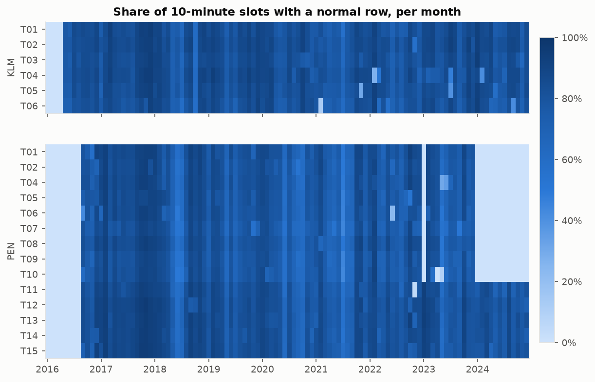
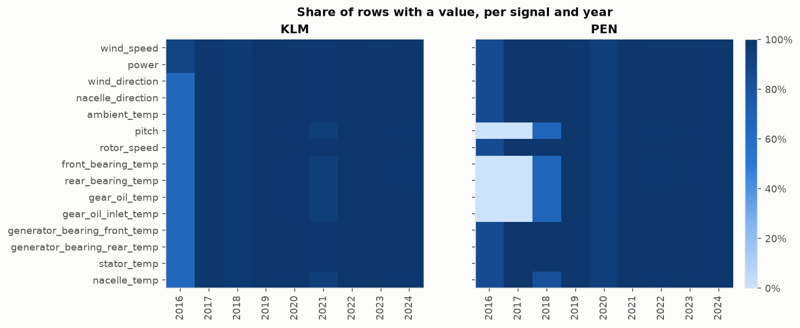
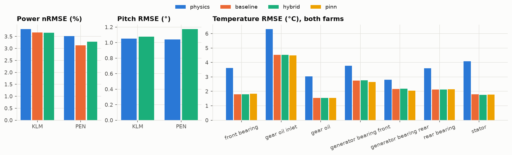
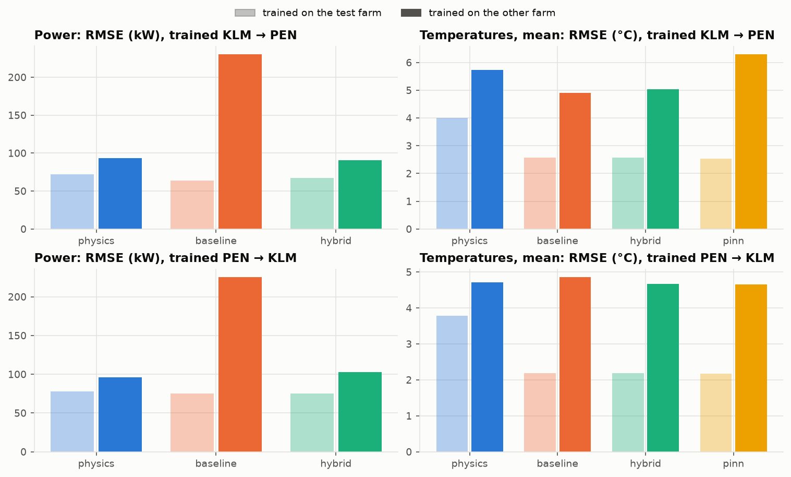
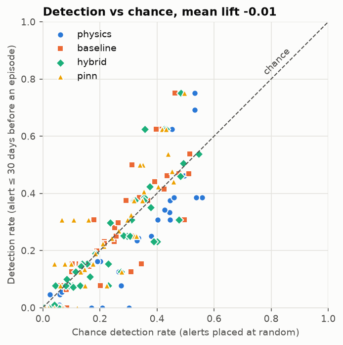
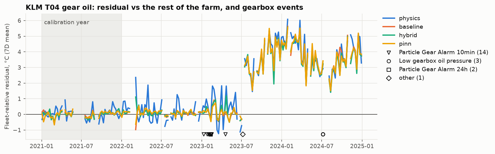
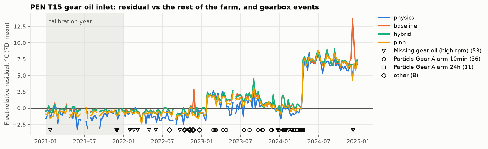
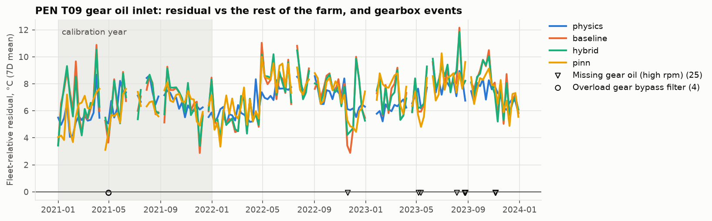

# Wind Farm Maintenance Digital Twin: Results Report

Kelmarsh (6 × Senvion MM92) and Penmanshiel (14 × Senvion MM82), 10-minute
SCADA data and status logs 2016–2024 (Cubico Sustainable Investments Ltd,
CC-BY-4.0; DOIs in the README). Status: proof of concept, 2026-11-19.

Figures are generated by `make report` (`src/report/build.py`, which also
prints the tables below) from the processed data, `models/*.json` and the
RDF graph. Method details and per-turbine results are in the README.

## 1. Summary

- **Within one farm, the ML models are the most accurate.** For power, a
  per-turbine LightGBM model (3.1–3.7 % nRMSE) beats one physics power
  curve per turbine type by 0.15–0.4 points. For temperatures, LightGBM,
  hybrid and PINN reach about 2.4 °C RMSE, against 3.9 °C for the lumped
  heat-balance model.
- **Across farms, physics transfers better than ML, but only clearly for
  power.** Trained on the other farm, LightGBM's power error triples
  (+200–259 %), physics and hybrid rise by only 23–37 %. For temperatures
  the physics model degrades least on all 14 target × direction pairs, yet
  LightGBM still has the lowest error on the other farm in 8 of 14.
- **Residual alerts do not predict the labelled fault events.** Across all
  models, thresholds and both evaluation scopes, the detection rate stays
  at the rate that randomly placed alerts would reach (mean lift −0.08 to
  +0.03).
- **Slow drift is the useful signal.** Gearbox drift alerts point at the
  turbines with the most gearbox events (exact permutation p = 0.074, 3
  flagged turbines per farm). In the clearest case, KLM T04's gear oil runs
  3–5 °C hotter than the rest of the farm from July 2023, after a run of
  particle alarms. All four model variants show it.

## 2. Data overview and gaps

| Farm | Turbines | Rows | Normal rows | Train / calibration / test |
|---|---|---|---|---|
| Kelmarsh | 6 | 2,839,104 | 78.5 % | 2016–2020 / 2021 / 2022–2024 |
| Penmanshiel | 14 | 5,758,976 | 76.3 % | 2016–2020 / 2021 / 2022–2023 (T11–T15: 2024) |

A row is **normal** when the turbine is past its commercial operations
date and outside a Stop event, the wind speed is 3–25 m/s, power is
positive, wind and ambient temperature are present, and the blades are not
pitched out below rated wind speed (curtailment); see `cleaning` in
`config.yaml`. Models fit normal rows of 2016–2020; alert thresholds come
from 2021, which no model sees; everything after 2021 is the test period.





- **Gaps in the published data:** Penmanshiel T01–T10 have no data for
  January 2023 (their 2023 export files start on 1 February) and none for
  2024. No row before a farm's commercial operations date is normal (Kelmarsh
  15 April 2016, Penmanshiel 1 September 2016).
- **Penmanshiel signals before mid-2018:** no pitch, main-bearing or gear-oil
  values on any turbine, so those models train on 2.5 years instead of 4.5.
- **Placeholders:** PEN T15 reports −273.2 °C on four temperatures for three
  days (18–21 April 2024, 442 rows): a sensor module offline. All those rows
  are non-normal and never reach a model or a score.
- Elsewhere 2–5 % of values are missing per signal.

## 3. Normal-behaviour models (in-site)

Every model predicts a signal's healthy value from operating conditions
and is scored on the same test rows (normal, 2022+, all variants
defined):

- **power:** physics = one power-coefficient curve per turbine type,
  scaled by each turbine's rotor area; baseline = LightGBM per turbine;
  hybrid = physics + per-turbine LightGBM residual model.
- **pitch** (above rated wind speed only): binned curve per turbine type,
  and hybrid.
- **7 drivetrain temperatures:** physics = heat balance (heat from power
  losses, cooling to the nacelle and by a regulated cooler above a learned
  set point) run freely from the operating inputs; baseline = LightGBM on
  power, rotor speed, ambient and nacelle temperature and their 1–24 h
  means; hybrid = physics + LightGBM residual; PINN = one network for all
  20 turbines with a heat-balance penalty. No variant sees the measured
  temperature, so slow overheating stays in the residual.



| Model | Farm | Physics | Baseline | Hybrid | PINN |
|---|---|---|---|---|---|
| Power, nRMSE (%) | KLM | 3.81 | 3.66 | 3.66 | – |
| Power, nRMSE (%) | PEN | 3.52 | 3.13 | 3.28 | – |
| Pitch, RMSE (°) | KLM | 1.05 | – | 1.08 | – |
| Pitch, RMSE (°) | PEN | 1.04 | – | 1.17 | – |
| Gear oil (°C) | KLM / PEN | 3.27 / 2.82 | 1.62 / 1.48 | 1.61 / 1.46 | 1.63 / 1.46 |
| Gear-oil inlet (°C) | KLM / PEN | 5.52 / 7.10 | 3.67 / 5.38 | 3.67 / 5.39 | 3.65 / 5.32 |
| Generator bearing front (°C) | KLM / PEN | 3.48 / 4.06 | 2.19 / 3.31 | 2.20 / 3.32 | 2.12 / 3.16 |
| Generator bearing rear (°C) | KLM / PEN | 3.00 / 2.62 | 2.56 / 1.79 | 2.56 / 1.80 | 2.41 / 1.69 |
| Stator (°C) | KLM / PEN | 3.77 / 4.39 | 1.63 / 1.95 | 1.60 / 1.90 | 1.62 / 1.94 |
| Main bearing front (°C) | KLM / PEN | 3.66 / 3.60 | 1.54 / 2.04 | 1.55 / 2.03 | 1.59 / 2.06 |
| Main bearing rear (°C) | KLM / PEN | 3.80 / 3.38 | 2.13 / 2.11 | 2.14 / 2.10 | 2.16 / 2.12 |

(Means over each farm's turbines. Pitch has no ML-only variant.)

- Power: one curve per turbine type comes within 0.4 points of a
  per-turbine LightGBM model, and is better on PEN T08, whose months of
  underperformance in 2021–2022 pull its own LightGBM model.
- Temperatures: the three ML variants are within about 0.1 °C of each
  other. The physics model is 1.5 °C worse because coolers and fans make
  several temperatures fall as power rises, which one lumped balance does
  not capture; the gear-oil inlet, which switches with the oil cooler, is
  the hardest signal for every variant.

## 4. Cross-site experiment

Each variant is trained on one farm (training years only) and tested on
the other farm's test rows, next to the model trained on that farm. The
farms have the same rated power (2.05 MW) but different rotors (92 m vs
82 m), so a model that only memorises a farm's power curve should fail.
Hypothesis (spec §7.11): physics and hybrid models transfer better than
ML-only models.



| Trained → tested | Signal | Physics | Baseline | Hybrid | PINN |
|---|---|---|---|---|---|
| KLM → PEN | power (kW) | 72.1 → 93.7 | 64.1 → 230.0 | 67.2 → 90.8 | – |
| KLM → PEN | gear oil | 2.82 → 5.15 | 1.48 → 4.33 | 1.46 → 4.74 | 1.46 → 9.08 |
| KLM → PEN | gear-oil inlet | 7.10 → 7.66 | 5.38 → 6.84 | 5.39 → 6.91 | 5.32 → 8.46 |
| KLM → PEN | generator bearing front | 4.06 → 5.53 | 3.31 → 4.71 | 3.32 → 4.91 | 3.16 → 5.67 |
| KLM → PEN | generator bearing rear | 2.62 → 3.55 | 1.79 → 2.48 | 1.80 → 2.69 | 1.69 → 3.25 |
| KLM → PEN | stator | 4.39 → 4.99 | 1.95 → 2.86 | 1.90 → 3.36 | 1.94 → 5.39 |
| KLM → PEN | main bearing front | 3.60 → 5.85 | 2.04 → 5.17 | 2.03 → 5.31 | 2.06 → 5.27 |
| KLM → PEN | main bearing rear | 3.38 → 7.39 | 2.11 → 7.91 | 2.10 → 7.39 | 2.12 → 6.89 |
| PEN → KLM | power (kW) | 78.1 → 96.0 | 75.1 → 225.2 | 75.0 → 102.6 | – |
| PEN → KLM | gear oil | 3.27 → 4.03 | 1.62 → 3.12 | 1.61 → 3.02 | 1.63 → 3.79 |
| PEN → KLM | gear-oil inlet | 5.52 → 5.98 | 3.67 → 5.00 | 3.67 → 5.19 | 3.65 → 5.25 |
| PEN → KLM | generator bearing front | 3.48 → 4.83 | 2.19 → 4.36 | 2.20 → 4.41 | 2.12 → 5.10 |
| PEN → KLM | generator bearing rear | 3.00 → 3.00 | 2.56 → 3.05 | 2.56 → 3.14 | 2.41 → 3.36 |
| PEN → KLM | stator | 3.77 → 4.02 | 1.63 → 4.02 | 1.60 → 3.41 | 1.62 → 5.03 |
| PEN → KLM | main bearing front | 3.66 → 4.21 | 1.54 → 5.33 | 1.55 → 4.85 | 1.59 → 2.68 |
| PEN → KLM | main bearing rear | 3.80 → 6.93 | 2.13 → 9.09 | 2.14 → 8.68 | 2.16 → 7.41 |

(Mean test RMSE over the test farm's turbines, trained on the test farm →
trained on the other farm; temperatures in °C.)

- **Power supports the hypothesis.** LightGBM has no rotor-size input and
  triples its error; physics scales the shared Cp curve by each turbine's
  rotor area and loses only 23–30 %. The hybrid keeps that robustness
  (+35–37 %) and is the most accurate cross-site model from Kelmarsh to
  Penmanshiel.
- **Temperatures support it only in part.** The physics model has the
  smallest increase in all 14 cases (+38 % on average, against +123–157 %
  for the ML variants), but it starts so far behind that LightGBM is still
  the most accurate on the other farm in 8 of 14 cases. The thermal hybrid
  behaves like LightGBM (its residual model dominates). The PINN transfers
  worst, because its mean turbine embedding is a poor stand-in for a turbine
  it has never seen (gear oil, Kelmarsh to Penmanshiel: 1.5 → 9.1 °C).
- The main bearings transfer worst for every variant: the two farms' bearing
  temperatures differ in level by more than any input explains.

## 5. Alerts and event-timed detection

Residual = measured − expected on normal rows (temperatures only at
≥ 500 kW), averaged over 24 h and made **fleet-relative** (minus the median
of the farm's other turbines, which removes weather, season and farm-wide
drift). An alert is an exceedance of the 2021 99.5 % quantile for at least
6 h. A fault **episode** (labelled status events of one turbine and
component less than 7 days apart) counts as detected when an alert of the
same component starts at most 30 days before it. **Chance** is what alerts
at the same rate, placed at random, would detect. All settings were fixed
before looking at test results.



Every point is one farm, component, signal and variant at one of six
threshold quantiles (90–99.9 %), for groups with at least 5 test
episodes; points on the diagonal detect no more than chance.

| Mean lift (detection − chance) | Physics | Baseline | Hybrid | PINN |
|---|---|---|---|---|
| Component scope (all events of the component) | −0.04 | +0.01 | −0.01 | +0.03 |
| Signal scope (only events a signal can precede) | −0.08 | +0.01 | +0.00 | −0.02 |

- No variant detects the labelled events better than chance, whether
  measured over all of a component's events or only the events a signal can
  physically precede (high bearing temperature, oil-cooler fan overload,
  choked oil filter and the like). The labelled events are mostly short
  stops such as "Missing gear oil" and particle alarms. No temperature or
  power anomaly lasting a day shows up in 10-minute data before them.
- **Drift alerts** (a 3-month mean score at least 1 °C above the
  calibration year's) behave differently: the turbines flagged by at least
  3 of 4 gearbox variants (KLM T01, T04, T06; PEN T08, T09, T15) had more
  gearbox events in the test period (Kelmarsh 8.3 vs 0.7 per turbine,
  Penmanshiel 43.7 vs 14.3), including the turbine with the most events on
  each farm. With 3 flagged turbines per farm this is suggestive only
  (p = 0.074). Generator drift alerts flag 13 of 20 turbines and are not
  specific.

## 6. Fault case studies

Each figure shows one turbine's fleet-relative residual for all four
thermal variants as 7-day means: 0 means the turbine runs like the rest of
its farm. Markers along the bottom are labelled status events of the
component. The shaded band is the calibration year.

### KLM T04 gear oil: particle alarms, then a hotter gearbox



From January to April 2023 the turbine logged 14 ten-minute and 2 daily
particle alarms (metal debris in the gear oil). The residual stays near 0
during the alarms. In July 2023 "Oil filter gear choked" is logged and the
turbine is out of normal operation for about two weeks; afterwards the
residual jumps to +3 to +5 °C and stays there to the end of 2024, and three
"Low gearbox oil pressure" events follow in July 2024. Above 500 kW the gear
oil used to follow the seasons (quarterly medians 51–55 °C in 2022); from
Q3 2023 it sits at about 57 °C in every quarter, winter included. All four
variants, the physics model among them, show the same step, so it is not an
artefact of one model. The order (debris first, heat later) fits
progressing gearbox wear. Without maintenance records this stays a
plausible reading, not a confirmed one.

### PEN T15 gear-oil inlet: a step after maintenance, probably not heat



T15 has the most gearbox events of either farm: "Missing gear oil" stops
from late 2021, seven "Oil filter gear choked" events in Q4 2022 and
particle alarms from Q4 2022 to mid-2024. The inlet residual steps up by
about +2 °C in January 2023, comes back towards 0 in early 2024 and jumps
to +7 °C after a three-day outage on 18–21 April 2024, when the sensor
module was offline. The gear-oil (sump) temperature does not move: at more
than 1 MW it stays at 54–57 °C throughout. Only the inlet rises, from 18–21 °C below
the sump temperature (2022) to about 13 °C below it (late 2024).
A hotter gearbox would warm the sump as well, so the jump more likely
reflects work on the oil-cooling circuit or a replaced or moved sensor.
The model flags a real change, and the maintenance record would have to
say whether it matters.

### PEN T09 gear-oil inlet: a turbine-specific offset, weak drift



T09's inlet already runs 5–7 °C above the rest of the farm in the calibration
year, so the drift alert from May 2022 reflects only +1–2 °C on top of an
existing offset. "Missing gear oil" stops then increase (1 in Q4 2022, 2 in
Q2, 8 in Q3 and 14 in Q4 2023). The timing fits a slowly worsening oil
supply, but the signal is small compared with the turbine's normal offset
and with the week-to-week spread, so this case alone would not justify an
inspection.

## 7. Limitations

- **Labels are not failures.** The status logs record stops and alarms, not
  component replacements or inspections. There are no main-bearing events
  and no generator-bearing or stator trips in the test period, so those
  models cannot be validated against faults. Episode counts are small
  outside the Penmanshiel gearbox (111).
- **No maintenance records**, so the case-study interpretations (wear,
  cooler work, sensor changes) cannot be confirmed.
- **10-minute averages** hide fast transients; the event-timed detection
  result applies to this resolution.
- **Thermal physics is a single lumped heat balance**; regulated coolers
  and fans limit it to about 3.9 °C RMSE, and a stronger physics penalty in
  the PINN costs accuracy.
- **Calibration year:** thresholds come from 2021, which includes PEN T08's
  underperformance episode; ML thermal residuals partly reflect
  extrapolation in warm test years (fleet-relative scoring removes most of
  it).
- **Cross-site** covers two farms of one manufacturer and rated power; the
  pooled thermal physics and the PINN's mean embedding are simple ways to
  serve unseen turbines, not tuned ones.
- **Data gaps:** January 2023 and all of 2024 are missing for Penmanshiel
  T01–T10; Penmanshiel pitch, gear-oil and main-bearing temperatures start
  in mid-2018. Kelmarsh yaw offsets cannot be identified from the data.

## 8. Reproduce

```bash
make setup data ontology train alerts evaluate curves cross-site report
```

`make report` takes about 20 s once the earlier steps have run. It rewrites
`docs/figures/` and prints this report's tables; the text above was
written against the run of 2026-11-19.
